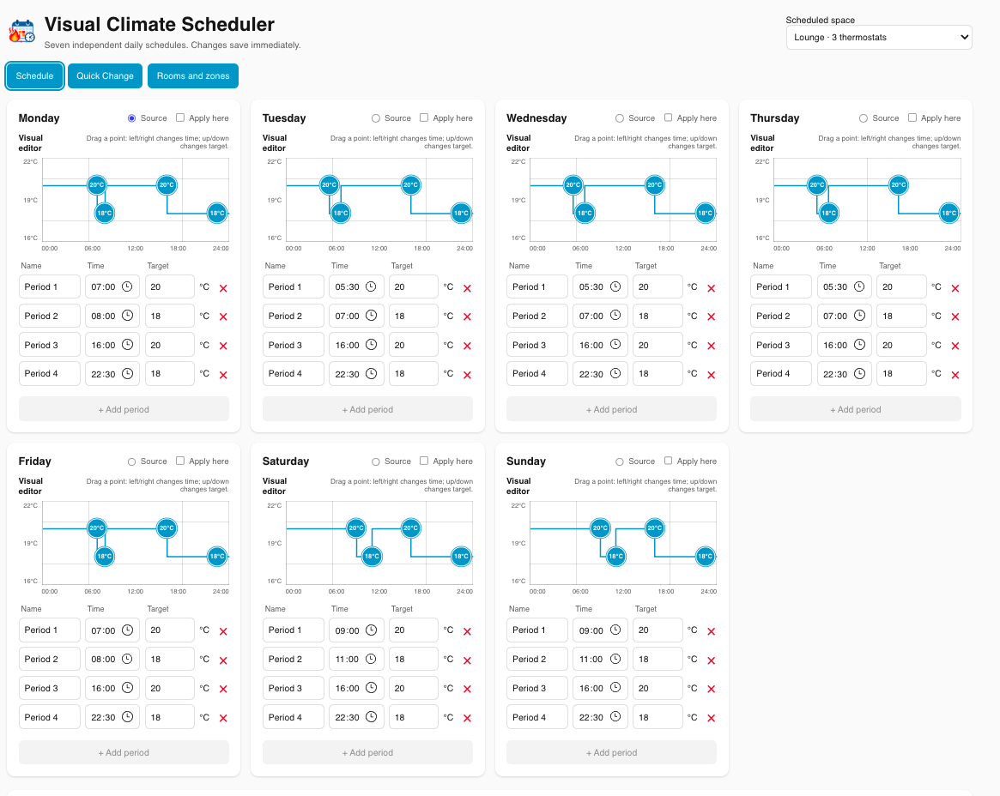

# HA Visual Climate Scheduler

A modern Home Assistant climate scheduler built around independent daily schedules, visual editing, and real-world usability.

## Visual Climate Scheduler 1.0.0

Read the [Instructions for Use](https://github.com/Buster1959/HA-Visual-Climate-Scheduler/wiki/Instructions-for-Use)
before installing. They cover room/zone configuration, the direct scheduler
launch, the optional sidebar shortcut, mobile use and current limitations.

The integration includes its own Home Assistant brand icon for current Home
Assistant releases.

Home Assistant setup and options screens include English, Danish, Dutch,
Finnish, French, German, Italian, Norwegian Bokmål, Spanish and Swedish. The
custom schedule editor itself remains English while its separate frontend
localisation framework is developed.

## What V1 provides

Open the full, admin-only scheduler from **Settings → Devices & services →
Visual Climate Scheduler → Configure**, without adding anything to the
sidebar. The same full editor can still be exposed as an optional sidebar
shortcut from **Rooms and zones**. The panel presents seven independent daily
schedules for each configured room or zone, with exact time and temperature
editing, up to four periods per day in this first UI.

The bundled editor has a versioned browser asset URL, so installing an update
also loads its matching screen instead of retaining an earlier cached editor.

When no rooms have been configured, the editor starts on **Rooms and zones**.
That setup view lists standard Home Assistant climate entities. Timeline lines
now continue the final target from the previous day across midnight, and
schedule copying has a **Select all** / **Clear all** shortcut.

Open **Rooms and zones** in the scheduler to add, modify or remove rooms and
zones. Modify keeps the stable room and its daily schedules, so it is the place
to add or remove thermostats. The scheduler is the day-to-day editor: choose a
source day, tick **Apply here** on destination days, then choose **Apply to
selected days** and Save. Hiding the sidebar checkbox removes only the optional
navigation shortcut; the direct integration launch and saved schedules remain
available.

The **Rooms and zones** page also provides JSON downloads for the complete
saved configuration and a persistent audit trail of recent target-temperature
applications, including their reason and outcome.

Every day card now has a visual temperature timeline. Drag a point left/right
to move its time (15-minute steps) or up/down to change its target (0.5°C
steps). Click a point to highlight its precise fields; those fields still allow
exact `HH:MM` entry such as `09:12`.

Use **Quick Change** for temporary holds without cluttering the Schedule view:
select rooms/zones (or Whole house), choose a `+/-` adjustment or exact target,
then hold it for 2 hours, 4 hours or until the next scheduled change.

When one room's schedule is right, expand **Copy schedule to rooms** on the
Schedule page, select the destination rooms/zones and copy it. This saves the
current source schedule and replaces only each selected destination's seven-day
schedule; its name, Area and assigned thermostats remain untouched.

At initial setup the integration records Home Assistant's configured
temperature unit (`°C` or `°F`) as the reference for all stored schedules. If
you later change Home Assistant between Celsius and Fahrenheit, remove and
re-add this integration before scheduling again; this avoids silently applying
saved values in the wrong unit.

## V1
- Visual PC/tablet timeline editor
- Seven independently stored daily schedules
- Dynamic Weekdays/Weekend/All Days grouping
- Up to four periods per day in the initial UI
- Drag time/temperature editing
- Exact time and setpoint entry
- Room/Area climate entity discovery
- Schedule copy/apply
- Mobile quick-control with temporary overrides
- Downloadable configuration and bounded thermostat application audit trail
- No dependency on the Heat Control System

## V2
Optional learning of repeated user behaviour, including temperature/time changes, with suggestions before automatic changes are considered.

See `docs/RELEASE_NOTES_1.0.0.md` for the V1 release summary.
