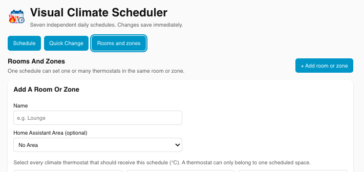
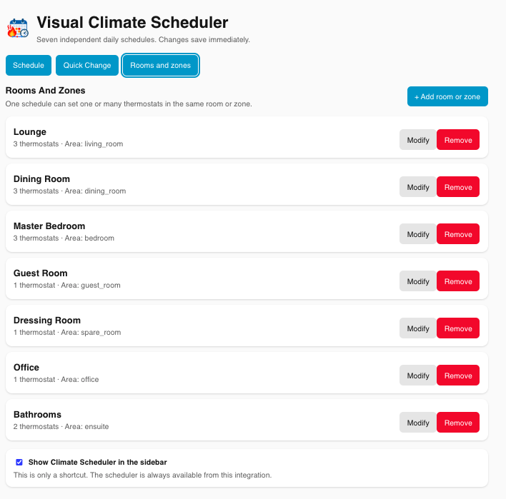
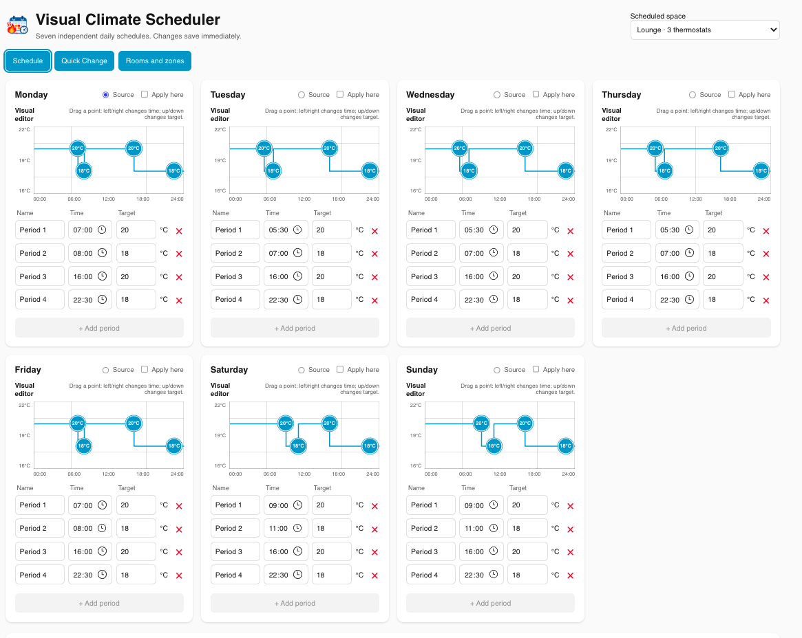
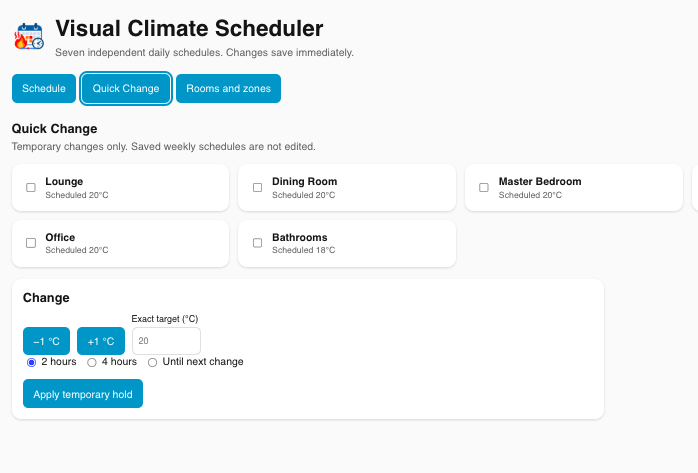
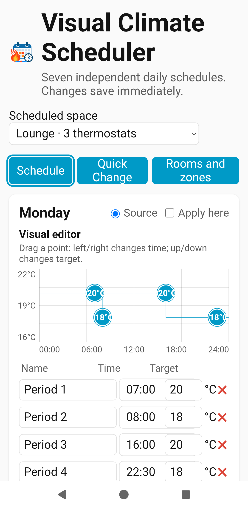
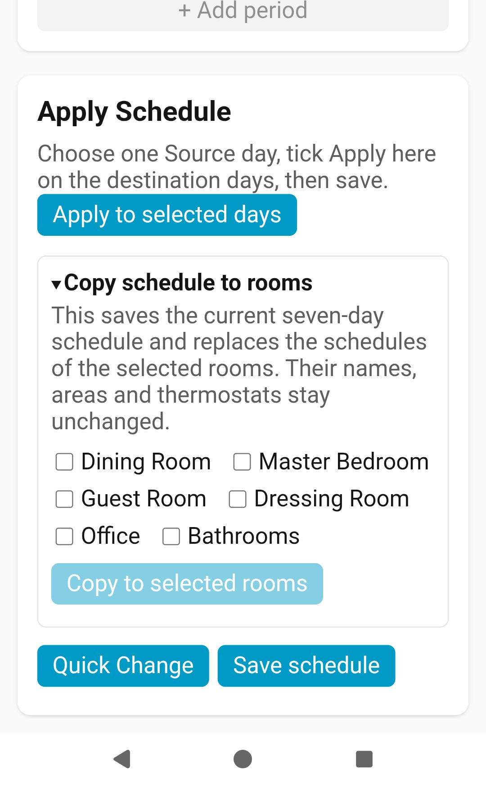
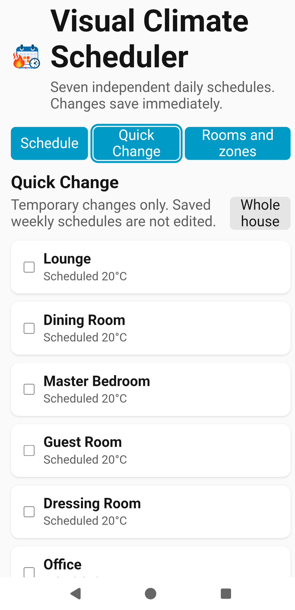
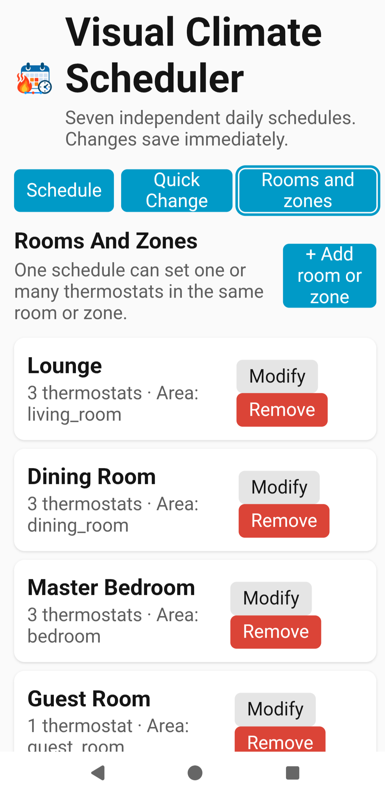
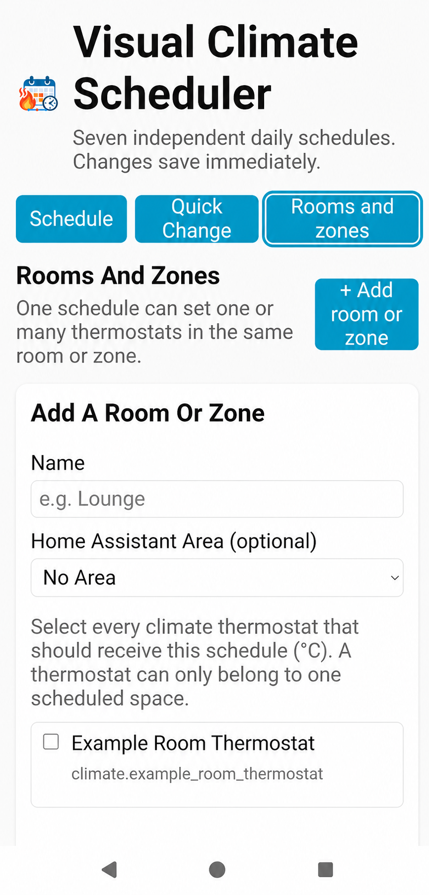

# Instructions for Use — V1.0.0

This guide describes the V1 release of Visual Climate Scheduler.

## Before you begin

- Back up your Home Assistant configuration.
- Test with one room or zone first. A saved schedule is live: the scheduler
  applies setpoints at schedule transitions and reconciles the current target
  when the integration starts.
- This build is admin-only. It includes timeline editing and temporary holds;
  use it first in a non-critical room or zone.

## Install and add the integration

1. Install this custom integration using your normal Home Assistant custom
   integration method. For a manual install, copy the
   `custom_components/visual_climate_scheduler` folder from the release
   into your Home Assistant `config/custom_components/` folder.
2. Restart Home Assistant.
3. Go to **Settings → Devices & services → Add integration**, search for
   **Visual Climate Scheduler**, and add it. The initial integration setup is
   intentionally empty.

On Home Assistant 2026.3 or newer, the integration card should show the
calendar, clock and heat icon included with this release after the restart.

## Configure rooms or zones

Go to **Settings → Devices & services → Visual Climate Scheduler → Configure**,
then open **Rooms and zones**.

If no rooms or zones exist yet, this is the screen that opens first. It lists
standard Home Assistant climate entities for assignment.

*The add form creates one scheduled space and assigns its climate thermostats.*

- **Add a room or zone** creates a named scheduled space. Select every climate
  thermostat that should receive the same target.
- **Modify** changes its name, optional Home Assistant Area or thermostat list
  without losing its existing daily schedule. Use this to add a second or third
  thermostat to a room.
- A climate thermostat can belong to only one scheduled space. This prevents
  two schedules from competing for the same device.
- **Remove a room or zone** removes that saved space and its schedule.

*The management view keeps room/zone membership separate from daily schedule editing.*

## Temperature unit

When the integration first opens, it stores Home Assistant's configured
temperature unit (`°C` or `°F`) as the reference for every schedule. Do not
change Home Assistant from Celsius to Fahrenheit, or Fahrenheit to Celsius,
and continue using the same integration: remove and re-add **Visual Climate
Scheduler** instead, then create schedules in the new unit. This is deliberate
safety behaviour; it prevents an old value being sent as though it used the new
unit.

## Open and use the scheduler

1. Go to **Settings → Devices & services → Visual Climate Scheduler →
   Configure**. This opens the scheduler directly; it does not require a
   sidebar item.
2. Select the room or zone to edit.
3. Each day is independent. Add up to four periods in this first UI, set the
   period name, exact `HH:MM` start time and target temperature, then choose
   **Save schedule**. Each card also has a visual timeline: drag a point
   left/right for time (15-minute steps), or up/down for target temperature
   (0.5°C steps). Click a point to highlight its precise fields; use those
   fields whenever an exact minute is needed.
4. To reuse a day: choose its **Source** radio button, tick **Apply here** on
   one or more destination days, choose **Apply to selected days**, then Save.
   The copied days are independent afterwards.
5. To copy a complete seven-day schedule to another room or zone, select the
   finished source room, expand **Copy schedule to rooms**, tick the destination
   rooms (or use **Select all**) and choose **Copy to selected rooms**. The
   same button changes to **Clear all** when every destination is selected. This also saves any current
   source edits. It replaces only each destination's daily schedule; its name,
   Area and selected thermostats are unchanged.

The visual line at the beginning of a day continues the final target from the
previous populated day. For example, a Monday evening target of 18°C remains at
18°C at the beginning of Tuesday until Tuesday's first change.

*Each day has its own visual timeline and exact time and temperature fields.*

### Optional sidebar shortcut

If you prefer a permanent navigation item, open **Rooms and zones** and tick
**Show Climate Scheduler in the sidebar**. This only adds the **Climate
Scheduler** sidebar shortcut; it does not create a second editor or change any
schedules. Unticking it removes that shortcut but the direct **Configure**
launch remains available.

### Download configuration and audit trail

At the bottom of **Rooms and zones**, the **Downloads** card provides two JSON
files:

- **Download configuration** exports the complete saved scheduler
  configuration, including settings, rooms/zones, assigned climate entity IDs
  and every daily period. Keep this file private if entity IDs or room names
  reveal details about your home. This V1 download is a readable backup and
  support aid; it is not yet an import/restore function.
- **Download audit trail** exports recent attempts by this integration to apply
  a target temperature. Each entry records the time, room/zone, climate entity,
  previous target when available, requested target, reason and outcome. Failed
  or unavailable targets are identified instead of being silently omitted.

The audit trail is stored separately from schedules, survives Home Assistant
restarts and retains the latest 5,000 entries. It begins collecting only after
the version containing this feature is installed, so it cannot reconstruct
earlier thermostat changes. It records scheduler applications, not every
temperature change made by other integrations or directly at a thermostat.

## Quick Change

Choose **Quick Change** in the editor to make a temporary adjustment without
altering any saved weekly schedule. Select one or more rooms/zones (or
**Whole house**), use `−1` / `+1` or enter an exact target, then select two
hours, four hours or until that room's next scheduled change. Active holds can
be cancelled individually. Temporary holds are runtime state and clear if Home
Assistant restarts.

*Quick Change applies a temporary hold without editing the saved weekly schedule.*

## Using the scheduler on mobile

The same editor adapts to a narrow mobile screen. The scheduled-space selector
moves above the navigation, and daily schedules are shown one card at a time.

*Edit a daily timeline or use its exact period fields from the mobile Schedule view.*

The apply, copy and save controls appear after the daily cards. Choose a Source
day and destination days before using **Apply to selected days**. Expanding
**Copy schedule to rooms** exposes the room destinations without changing their
names, Areas or thermostat assignments.

*Day application, whole-schedule copying and saving remain separate actions.*

For a fast adjustment, **Quick Change** is usually the most convenient mobile
view. Select individual rooms or choose **Whole house**, then continue to the
change and duration controls below the room list.

*Select the scope of a temporary hold before choosing its temperature and duration.*

Room and zone management is also available on mobile. Existing spaces are
shown as cards with **Modify** and **Remove** actions, while **Add room or zone**
opens the same name, Area and climate-target form used on larger screens.

*The mobile setup form uses a privacy-safe example thermostat; select the real Home Assistant climate entities in your installation.*

## Current limits and safe testing

- The storage model can retain more than four periods per day, but this first
  editor presents up to four.
- Duplicate times within a day are rejected. Periods are saved in time order.
- A temporary hold is not restored after a Home Assistant restart.
- If the direct **Configure** launch or optional sidebar shortcut does not
  appear, confirm you are an administrator and refresh the Home Assistant
  browser page after changing the setting.

## Reporting feedback

When reporting a problem, include your Home Assistant version, the integration
version (`1.0.0`), the affected room/zone and the exact steps that led to
the result. Do not include secrets or full Home Assistant backups.
